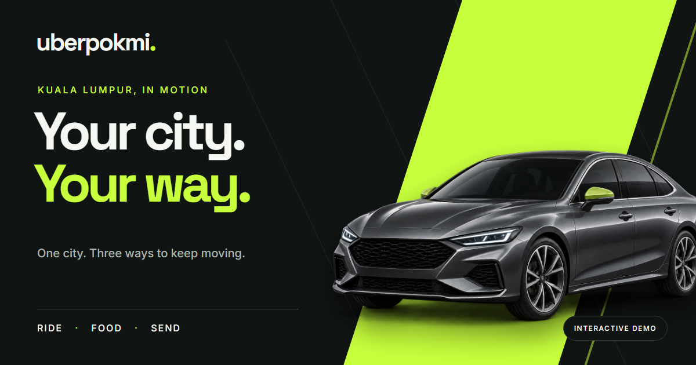

<div align="center">
  <h1>uberpokmi</h1>
  <p><strong>Interactive Malaysian Mobility Superapp Simulation (Ride, Food, Delivery)</strong></p>
  <p>
    <a href="https://uberpokmi.syahmiaof.my"></a>
    <a href="https://github.com/syahmiaof/uberpokmi"></a>
    <a href="https://github.com/syahmiaof/uberpokmi/actions"></a>
    <a href="LICENSE"></a>
  </p>
  <p>
    
    
    
    
    
  </p>
</div>

---



UberPokmi is a frontend-only simulation set around Kuala Lumpur. Try a fictional ride, food order or parcel delivery, advance its status and inspect the result in Activity. It uses local demo state, not a live transport or commerce service.

## 🚗 What is Implemented

- **Ride:** Choose places and vehicle class, apply a demo offer, book now or schedule, then advance a fictional trip.
- **Food:** Browse fictional restaurants, customize items, manage a single-restaurant cart and complete a demo checkout.
- **Delivery:** Enter sender, recipient and parcel details, choose a vehicle and advance to simulated proof of delivery.
- **Shared:** Activity, receipts, saved addresses, offers, notifications, theme, demo chat, ratings and reset.
- Responsive desktop/mobile UI and an offline schematic map with optional OpenStreetMap tiles.

Prices are calculated in integer sen. Distance is estimated from coordinates with a fixed multiplier; it is not live routing.

## 🛠️ Run and Verify

Node.js 20.19+ or 22.12+ is required.

```bash
# Install dependencies
npm ci

# Run development server
npm run dev

# Run linters and typecheck
npm run lint
npm run typecheck

# Run automated tests
npm test
npm run build
```

Optional browser E2E and production smoke checks:
```bash
npx playwright install chromium
npm run test:e2e
npm run smoke:prod
```

## 📁 Project Structure

- `src/domain.ts` — types, pricing and validation.
- `src/data.ts` — fictional places, restaurants and menus.
- `src/store.tsx` — shared local state and status transitions.
- `src/BookingForms.tsx`, `src/Food.tsx`, `src/Tracking.tsx` — service flows.
- `src/MapExperience.tsx` — schematic and optional street map.
- `tests/` and `scripts/` — browser checks and production smoke script.

## 📜 Assets and Limits

Food photographs represent dishes, not actual fictional restaurants. See [image credits](public/images/credits.html), [asset registry](public/images/food-assets.json) and [ASSETS.md](ASSETS.md). The app has no real payment, dispatch, GPS, login, messaging or delivery network. Browser local storage holds demo state under `uberpokmi-demo-v1`; avoid entering real private contact details.

The main branch is configured for Vercel deployment at [https://uberpokmi.syahmiaof.my/](https://uberpokmi.syahmiaof.my/).

## 📄 License

This project is open-sourced under the [MIT License](LICENSE).  
Copyright © 2026 Muhammad Syahmi (syahmiaof).
